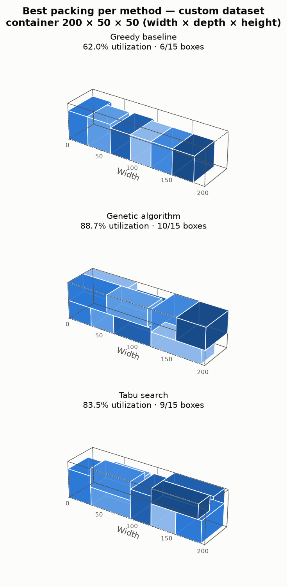
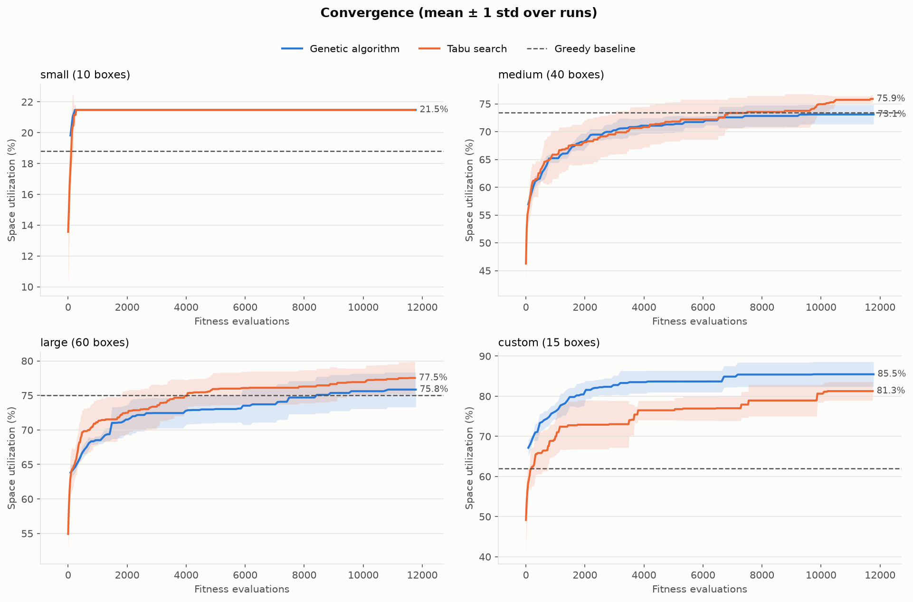
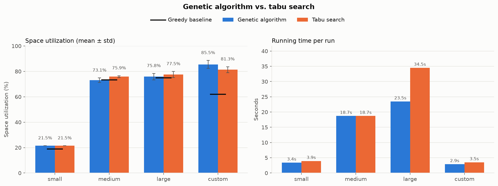

# 3D Bin Packing with Metaheuristics

**Genetic algorithm vs. tabu search for the single-container 3D bin packing problem**, written in Python.

Given a set of rectangular boxes and one container of fixed size, the goal is to pack as much volume as possible:
boxes must stay inside the container, must not overlap, and may only be rotated into their allowed orientations.
The number of possible packings explodes with the number of boxes, so the problem is solved with two
metaheuristics that are compared on solution quality, stability across runs and running time.

<p align="center">
  
</p>

## Highlights
- **Genetic algorithm** with tournament selection, order crossover (OX) and inversion mutation.
- **Tabu search** over the same encoding, with a short-term tabu list and an aspiration criterion.
- **Extreme-point decoder** (bottom-left-back) that turns any chromosome into a concrete packing.
- **Independent feasibility checker** that validates every solution: inside the container, no overlaps, allowed orientations only.
- **Greedy baseline** (largest box first, best orientation) to measure how much the metaheuristics actually gain.
- **Fair, reproducible experiments:** both methods get the same evaluation budget (~11.8k fitness evaluations)
  and are run several times with fixed seeds to measure stability.
- **3D visualizations**, convergence curves and comparison charts generated automatically.
- **33 automated tests** (pytest).

## Results
Space utilization over **5 independent runs per method** (seeds 0–4), with the same budget of ~11.8k fitness
evaluations for both methods. Every one of the 40 solutions passed the feasibility checker.

| Dataset | Boxes | Greedy baseline | GA mean ± std | GA best | GA time | TS mean ± std | TS best | TS time |
|---|---|---|---|---|---|---|---|---|
| small | 10 | 18.8% | 21.5% ± 0.0 | 21.5% | 3.4s | 21.5% ± 0.0 | 21.5% | 3.9s |
| medium | 40 | 73.4% | 73.1% ± 1.7 | 76.3% | 18.7s | 75.9% ± 0.7 | 76.7% | 18.7s |
| large | 60 | 75.0% | 75.8% ± 2.5 | 79.6% | 23.5s | 77.5% ± 2.3 | 81.0% | 34.5s |
| custom | 15 | 62.1% | 85.5% ± 3.1 | 88.7% | 2.9s | 81.3% ± 2.3 | 83.5% | 3.5s |

<p align="center">
  
</p>
<p align="center">
  
</p>

### Key findings
- **Small instance:** both methods pack all 10 boxes (the optimum) in under 300 evaluations, in every run.
  The greedy baseline leaves 2 boxes out.
- **Hard instance (`custom`):** similar-sized boxes are where the metaheuristics pay off the most: the GA reaches
  **85.5% vs. 62.1%** for the greedy baseline (+23 points) and beats tabu search by 4 points. Order crossover
  recombines good sub-sequences from different parents, which helps when only a few combinations fit well.
- **Random instances (`medium`, `large`):** largest-box-first greedy is already a strong heuristic (73–75%).
  Tabu search is the best method on both, and the most stable on `medium` (±0.7). The GA starts from a random
  population and, on average, only matches the greedy baseline on `medium`.
- **Running time:** with equal evaluation budgets the running times are close. Tabu search is slower on `large`
  because its solutions pack more boxes (30–33 vs. 25–29), which makes every decoding step more expensive.
- **Next step:** seeding the initial population (GA) or the starting solution (tabu search) with the greedy
  solution would guarantee results at least as good as the baseline and combine the strengths of both.

## How it works

### Problem variant
- one container (200 × 50 × 50 in the experiments) and a set of rectangular boxes;
- boxes are placed with their edges parallel to the container's edges;
- no overlaps, every box fully inside the container;
- each box may only use its allowed orientations (all 6 rotations by default, or a fixed subset);
- **objective:** maximize space utilization = packed volume / container volume. Boxes that don't fit are left out.

### Solution encoding
A solution is a pair **(order, orientations)**:
- `order` is a permutation of the box indices: the sequence in which boxes are packed;
- `orientations[i]` selects which rotation box `i` uses.

Keeping the two parts separate lets each operator work on the part it understands, and a permutation guarantees
every box appears exactly once.

### Decoder: extreme points, bottom-left-back
The decoder turns a chromosome into placements. It keeps a set of *extreme points* (candidate corners, starting
with `(0, 0, 0)`) and, for each box in order, places it at the first point, in bottom-left-back order, where it fits
without overlapping anything. The placed box then adds three new extreme points at its far corners.
Points that end up inside a placed box can never be used again and are pruned, and the overlap test is inlined.
This makes decoding 2–2.5× faster on the larger datasets while producing exactly the same packings.

### Genetic algorithm
| Component | Choice |
|---|---|
| Population | 80 individuals, 150 generations, elitism of 2 |
| Selection | tournament (k = 3) |
| Crossover (85%) | order crossover (OX) on the order + uniform crossover on the orientations |
| Mutation (15%) | reverse a random segment of the order + re-roll a few orientations |

Tournament selection was chosen because its selection pressure is tuned by a single parameter `k`, it is not
dominated by one very fit individual (unlike roulette selection), and it costs only O(k) per selection.

### Tabu search
| Component | Choice |
|---|---|
| Neighborhood | 25 random neighbors per step: swap two boxes in the order (70%) or change one orientation (30%) |
| Tabu list | the last 15 moves |
| Aspiration | a tabu move is accepted if it beats the best solution found so far |
| Budget | 470 iterations (same number of evaluations as the GA) |

Tabu search is a good counterpart to the GA: one explores with a whole population, the other intensifies around a
single solution, so comparing them shows the exploration vs. exploitation trade-off on the same encoding.

### Feasibility checker
Every solution produced by any method is re-checked independently of the decoder: each box must lie inside the
container, use an allowed orientation, appear only once and not overlap any other box. The experiment stops with an
error if an infeasible solution is ever produced.

## Getting started
Requires **Python 3.10+**.

```bash
git clone https://github.com/craciunnicolas10/3d-bin-packing-metaheuristics.git
cd 3d-bin-packing-metaheuristics
python -m venv .venv
.venv\Scripts\activate          # Windows
# source .venv/bin/activate     # Linux / macOS
pip install -r requirements.txt
```

Run the full experiment (all datasets, 5 runs per method); plots and a summary table are written to `results/`:
```bash
python main.py
```

Other options:
```bash
python main.py --datasets custom medium --runs 3   # selected datasets, fewer runs
python main.py --seed 42                           # different seeds
python main.py --show                              # also open the plots in a window
python main.py --verbose                           # print progress during each run
```

Run the tests:
```bash
pytest
```

## Datasets
| Name | Boxes | Description |
|---|---|---|
| `small` | 10 | random boxes (15–45% of each container side); all of them fit, so the optimum is known |
| `medium` | 40 | random boxes, 113% of the container's volume |
| `large` | 60 | random boxes, 165% of the container's volume |
| `custom` | 15 | hand-made boxes of similar sizes (135% of the container's volume), hard to combine without gaps |

New instances can be generated with `generate_dataset()` in `binpacking/datasets.py`, including instances where
every box has a single fixed orientation (`fixed_orientations=True`).

## Project structure
```
binpacking/
├── models.py              Box, Container, Placement, Solution
├── decoder.py             extreme-point bottom-left-back decoder
├── feasibility.py         independent feasibility checker
├── baseline.py            greedy constructive baseline
├── genetic_algorithm.py   genetic algorithm
├── tabu_search.py         tabu search
├── datasets.py            benchmark instances and generator
└── visualizer.py          3D packings, convergence and comparison plots
main.py                    experiment runner (CLI)
tests/                     automated tests
results/                   generated plots and summary table
```

## Authors
Developed as a university team project for a course on metaheuristic optimization algorithms by:
- **Nicolas Crăciun** – [@craciunnicolas10](https://github.com/craciunnicolas10)
- **Cristian Buraga-Vilcu**

## Tech stack
Python · NumPy · Matplotlib · pytest
